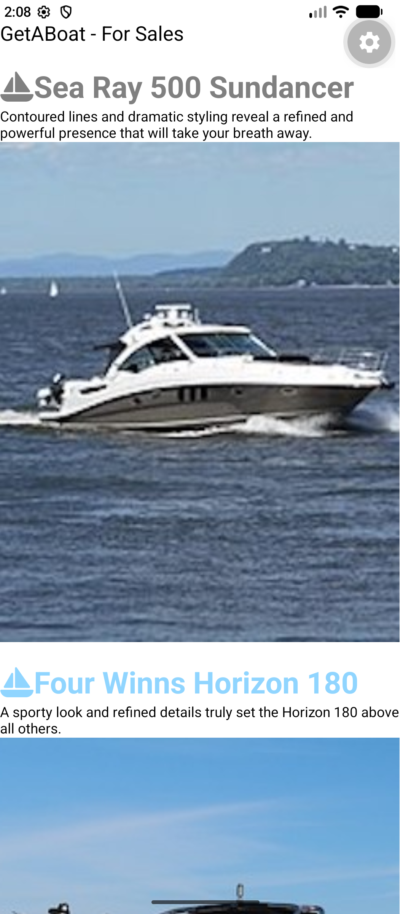
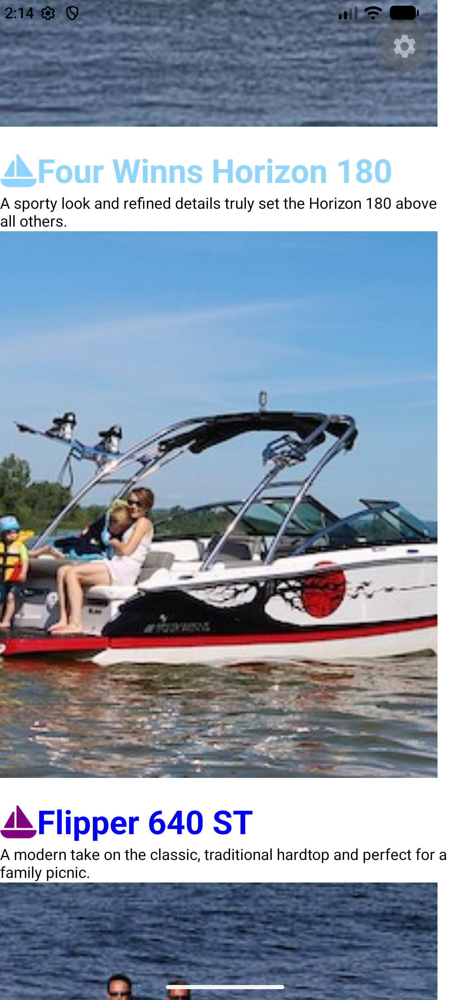
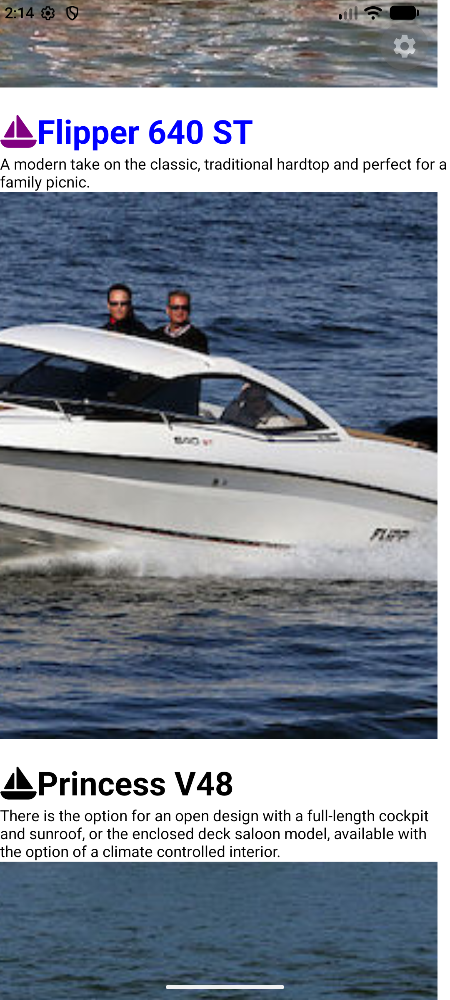
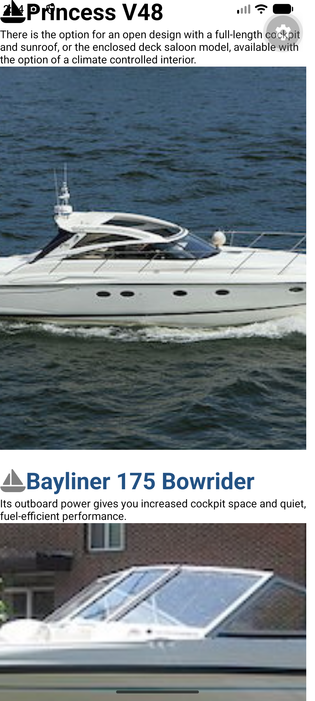
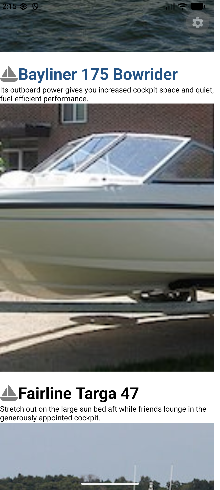
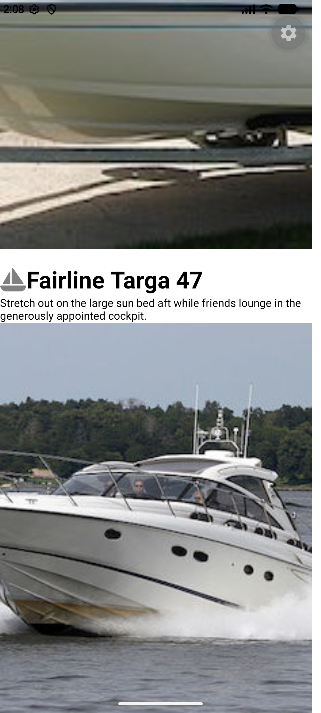
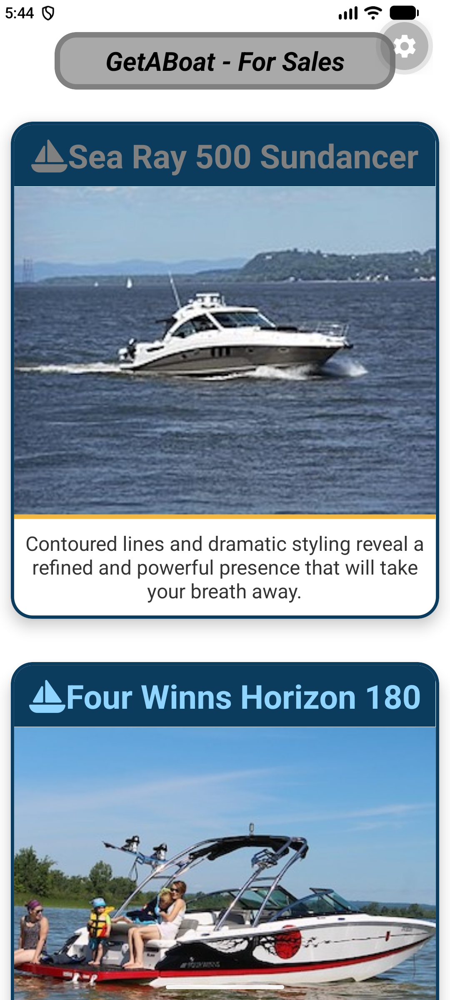
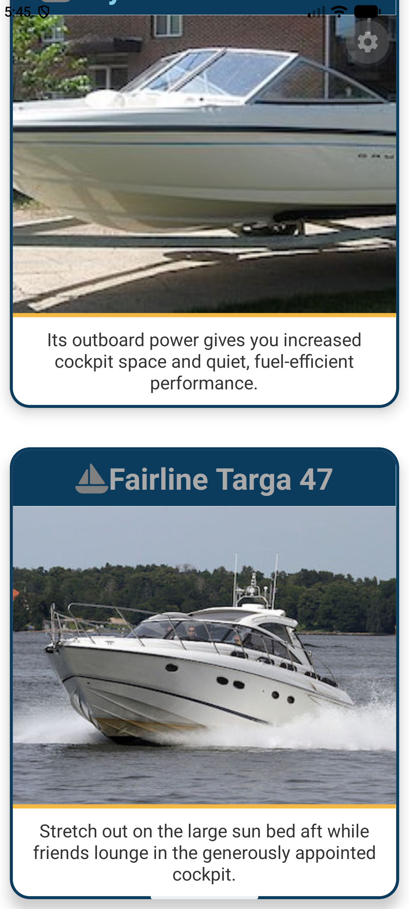
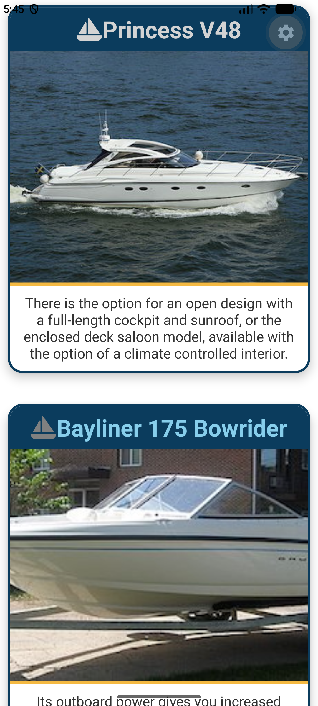
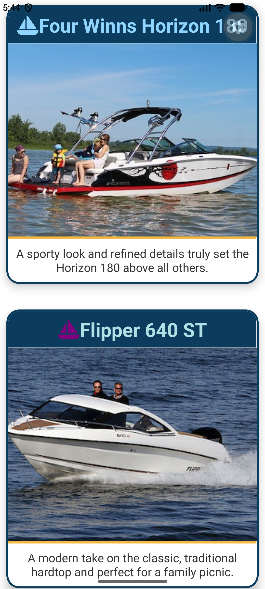

App Name
A brief description of the mobile application and its purpose.

This is an app for a boat dealer. It shows 6 boats on a scrollable page, each with its name, photo and description. 

ScreenShots of App BEFORE applying Stylesheet changes
Screenshots:

ScreenShots of App AFTER applying Stylesheet changes
Screenshots:

Link to Demo Video with audible narration explaining styling changes with code reference
Demo Video Link:
https://drive.google.com/file/d/1ksMbilVhoKftcR3pqdalBWJTYx-lgMJM/view?usp=sharing